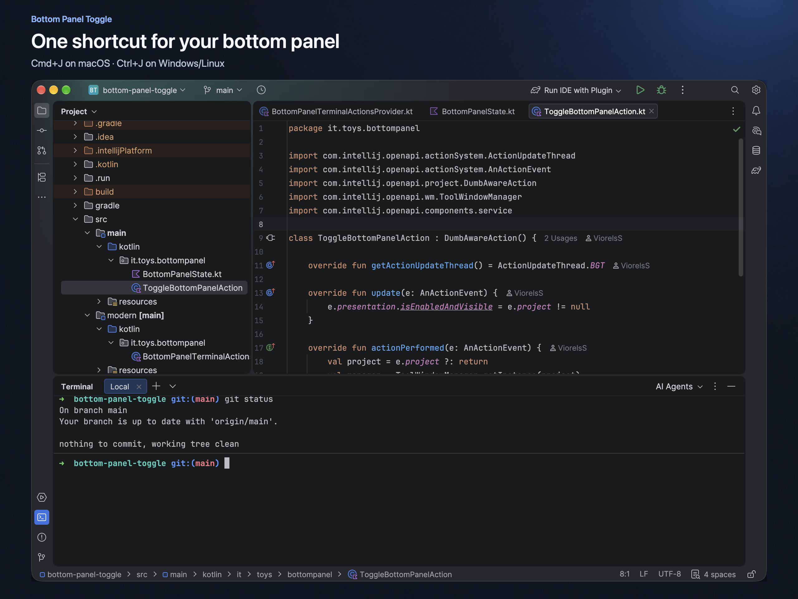
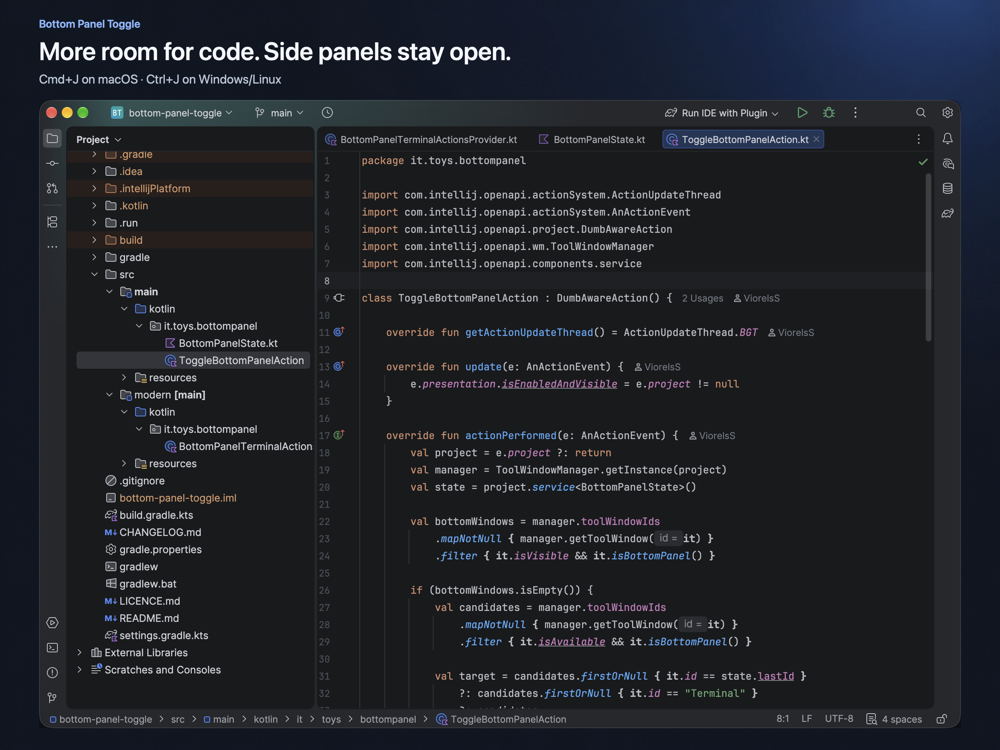

#  Bottom Panel Toggle

  
  

One shortcut to hide and restore the bottom panel in IntelliJ IDEA.

I built this to switch between code and bottom tool windows without hiding
Project or other side panels.

**macOS:** `Cmd+J` · **Windows / Linux:** `Ctrl+J`

- **Bottom panel visible:** hide visible bottom tool windows and focus the editor.
- **Bottom panel hidden:** restore and focus the last used bottom tool window.

Works from the editor or a tool window. With no previous panel, it opens an
available bottom tool window, preferring Terminal.

## Install

Install from [JetBrains Marketplace](https://plugins.jetbrains.com/plugin/35398-bottom-panel-toggle)
to get an available compatible version, or download the ZIP for your IDE:

| IntelliJ IDEA | Download |
| --- | --- |
| 2024.1–2025.3.x | [1.0.2 (legacy)](https://github.com/ViorelsS/bottom-panel-toggle/releases/download/v1.0.3/bottom-panel-toggle-1.0.2.zip) |
| 2025.3.6.1–2026.2.x | [1.0.3 (modern)](https://github.com/ViorelsS/bottom-panel-toggle/releases/download/v1.0.3/bottom-panel-toggle-1.0.3.zip) |

If both packages support your IDE, choose **1.0.3**.
Install a ZIP through **Settings → Plugins → gear menu → Install Plugin from Disk…**.

## Setup

- **Keymap:** in **Settings → Keymap**, search for **Toggle Bottom Panel**.
  Assign the shortcut if needed and resolve any conflict with **Insert Live Template**.
- **Legacy terminal:** in **Settings → Tools → Terminal**, select **Classic** and
  disable **Override IDE shortcuts**. Apply the changes and open a new terminal tab.
- **Modern terminal:** the Reworked Terminal integration allows the shortcut with
  **Override IDE shortcuts** enabled. For Classic Terminal, disable that setting.

The command is also available from **Tools → Toggle Bottom Panel**.

[Development guide](docs/DEVELOPMENT.md) · [Changelog](CHANGELOG.md) ·
[Report an issue](https://github.com/ViorelsS/bottom-panel-toggle/issues)

[MIT](LICENCE.md) © 2026 Viorelss.
